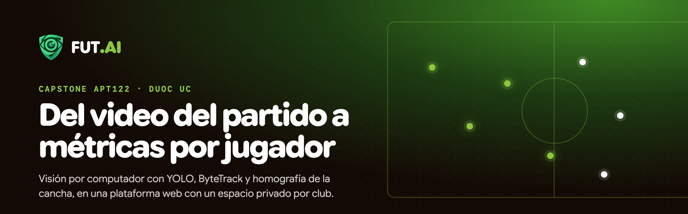
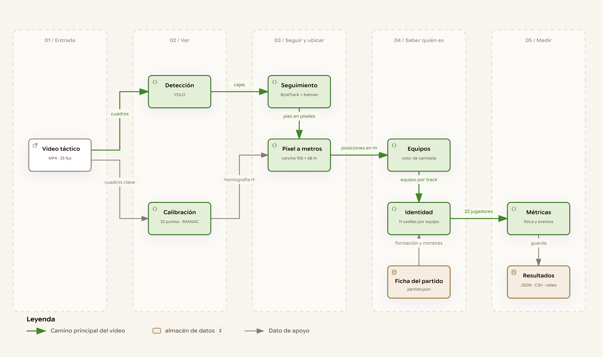
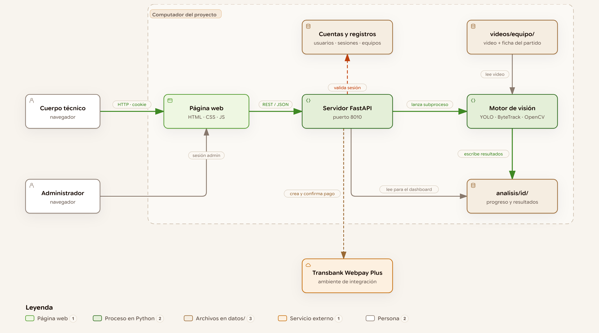
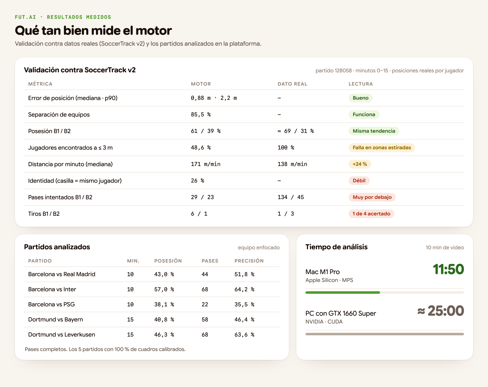

  

  
  
  
  

---

## Qué es FUT.AI

**FUT.AI** convierte el video de la cámara táctica de un partido de fútbol en métricas por **equipo, línea y jugador**, sin chalecos GPS ni cámaras propietarias. Está pensada para cuerpos técnicos de clubes formativos, regionales y de segunda división, que graban sus partidos pero no tienen cómo convertir ese video en datos.

- **Motor de visión:** detecta jugadores, árbitros y balón con YOLO, los sigue con ByteTrack y calibra la cancha con 32 puntos y una homografía para medir en metros.
- **Identidad:** separa los equipos por color de camiseta y asigna los 11 jugadores con nombre a partir de la ficha del partido.
- **Métricas:** distancia, velocidad máxima, sprints, zonas de intensidad, mapas de calor, posesión, pases, pérdidas, recuperaciones y tiros.
- **Plataforma web:** cada club tiene su espacio privado con sus colores, historial y dashboard; el registro incluye pago de prueba con Transbank Webpay Plus.

> **Diagramas interactivos, con recorrido guiado:** **[futai-diagramas.netlify.app](https://futai-diagramas.netlify.app)**

## Cómo funciona

## Arquitectura

Tres piezas en un mismo computador: una **página web** sin compilación, un **servidor** en Python con FastAPI y el **motor de visión**, que el servidor lanza como proceso aparte (un análisis a la vez). Los datos se guardan en archivos JSON y CSV.

## Resultados medidos

Validado contra **SoccerTrack v2**, un dataset con posiciones reales de cada jugador: error de posición de **0,88 m** (mediana) y separación de equipos de **85,5 %**. La identidad exacta (26 %), los pases y los tiros todavía no son confiables, y lo declaramos así.

## Tecnologías

| Área | Tecnologías |
|---|---|
| Visión por computador | Ultralytics YOLO, Supervision (ByteTrack), OpenCV, PyTorch (MPS / CUDA / CPU) |
| Datos | NumPy, pandas, SciPy, scikit-learn · archivos JSON y CSV |
| Servidor | Python, FastAPI, Uvicorn |
| Web | HTML, CSS y JavaScript sin compilación |
| Pagos | Transbank Webpay Plus (ambiente de integración) |
| Diagramas | Archify |

## Estructura del repositorio

Las carpetas siguen la pauta de evidencias de la asignatura.

| Carpeta | Contenido |
|---|---|
| [`Fase 1`](Fase%201) | Definición del proyecto: evidencias individuales (1.1, 1.2, 1.3) y grupales (presentación, 1.4, 1.5, mockups). |
| [`Fase 2`](Fase%202) | Desarrollo, versión original (octubre). Se conserva como registro histórico. |
| [`Fase 2 v2`](Fase%202%20v2) | **Desarrollo, versión 2:** guías 2.4 y 2.6 y entregables ágiles reescritos para que coincidan con lo que realmente se construyó, con diagramas nuevos. |
| [`Fase 3`](Fase%203) | Cierre: diarios de reflexión 3.1 y presentación final. |

### Por qué hay una Fase 2 v2

La primera versión de la Fase 2 describía un pipeline en Google Cloud (Cloud Run, Cloud SQL, Docker). Ese camino se probó con otro modelo y se descartó, porque el motor desarrollado en local dio mejores resultados. La versión 2 describe el producto que se entrega.

## Equipo

| Integrante | Rol |
|---|---|
| Sebastián López | Motor de visión, servidor y plataforma web |
| Héctor Arriagada | Motor de visión |
| Renato Palma | Documentación |
| Cristóbal Sepúlveda | Documentación |

**Metodología:** Scrum hasta el 18 de octubre de 2026 y luego Kanban, con minutas de las decisiones.

Capstone APT122 · Ingeniería en Informática · Duoc UC · 2026

